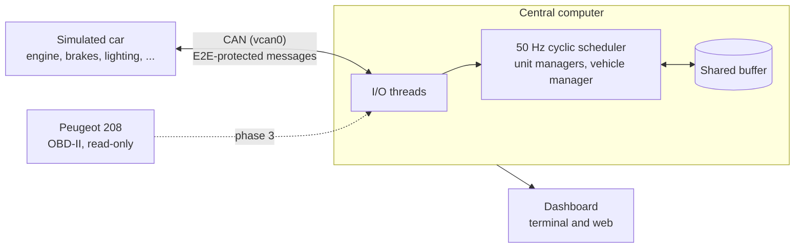

# Car Central Computer

[](https://github.com/levihorvitz/car-gateway/actions/workflows/build.yml)
[](https://github.com/levihorvitz/car-gateway/actions/workflows/requirements.yml)
[](https://github.com/levihorvitz/car-gateway/actions/workflows/icd.yml)

A central computer (gateway) for a car, in C++17 on Linux. It runs a 50 Hz cyclic scheduler, monitors the vehicle units over a CAN bus, detects and handles faults, decides one vehicle state, and shows the car's state on a dashboard.

During development every vehicle unit is a simulated process on a virtual CAN bus. In the final phase the same code runs on a Raspberry Pi in a 2015 Peugeot 208, reading the real car through its OBD-II port, read-only.

The project follows an industry-style process: requirements with traceability, architecture decision records, an interface control document under change control, test-driven development, and code review and CI on every change.

## Architecture



All logic runs in one thread, in a fixed order, at a fixed rate: no locks, the same behaviour on every run, and every timing case can be reproduced in a test with a fake clock. Details in [docs/architecture.md](docs/architecture.md).

## Status

**Phase 1 — working skeleton** (milestone `v0.1.0`), in progress.

| Done | Next |
| --- | --- |
| 40 system requirements, managed in StrictDoc | Communication layer: bus interface, I/O threads, E2E codec |
| Software architecture and ADRs 0001–0007 | Shared buffer |
| Cyclic scheduler: 11 software requirements, 18 unit tests | Manager base class and fault mechanism |
| Communication matrix (ICD) v0.1.0 for engine, brakes and lighting | Engine, brakes, lighting and vehicle managers |
| CI: build and tests with AddressSanitizer, UBSan and ThreadSanitizer; requirements and ICD checks | Simulated units and terminal dashboard |

Later phases: full simulation with built-in test and fault injection (`v0.2.0`), then the real car with GPS time and a hardware watchdog (`v1.0.0`). Work is tracked on the project board.

## Engineering practices

| Practice | Where |
| --- | --- |
| System and software requirements with parent links and a traceability matrix | [docs/requirements](docs/requirements) (StrictDoc) |
| Architecture decision records | [docs/adr](docs/adr) |
| Interface control document under change requests and semantic versioning | [icd/car_gateway.dbc](icd/car_gateway.dbc), [docs/icd](docs/icd) |
| Detailed design before implementation | [docs/design](docs/design) |
| Test-driven development; injected clock for deterministic timing tests | [tests](tests) |
| No dynamic allocation after initialisation; strict warnings as errors | [docs/coding-guidelines.md](docs/coding-guidelines.md) |
| Protected `main`: pull request, review and green CI for every change | `.github/workflows` |

## Quick start

On Ubuntu 24.04 (native or WSL). Full setup: [docs/development-setup.md](docs/development-setup.md).

```bash
cmake -S . -B build
cmake --build build -j
ctest --test-dir build --output-on-failure

./build/apps/scheduler_demo 5          # the scheduler on the real clock, with live timing stats
strictdoc server .                     # browse the requirements at http://127.0.0.1:5111
cantools dump icd/car_gateway.dbc      # the communication matrix, with bit layouts
```

## Repository layout

```
apps/            Executables (scheduler demo)
docs/            Architecture, ADRs, requirements, design notes, ICD rules, guidelines
icd/             Communication matrix (DBC)
include/         Public headers, by area (core, app)
src/             Implementation, by area
tests/           Unit tests, fakes and test support
.github/         CI workflows and issue templates
```

## Team

- **Levi Hurvitz** — design and implementation
- **Reut** — code review and development
- **Sapir** — documentation review
