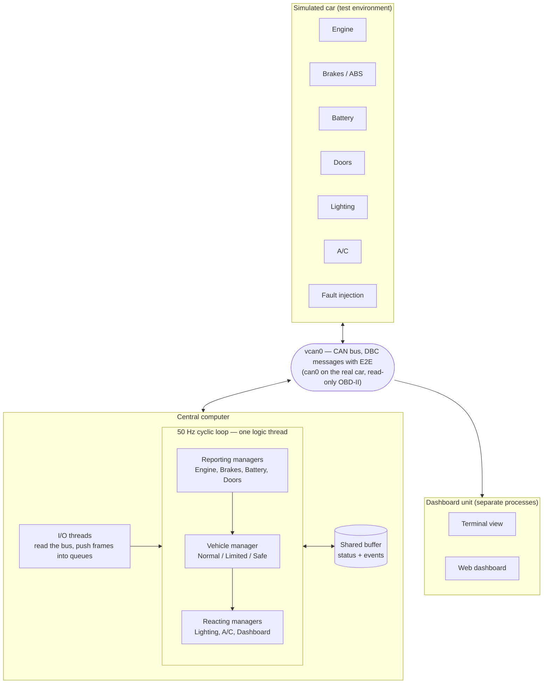

# Software Architecture

This document describes how the car central computer is built: its components, how they talk to each other, and how they run. It sits between the requirements (`docs/requirements/`) and the detailed design of each component (`docs/design/`). The reasons behind each major decision are recorded as Architecture Decision Records in `docs/adr/`.

## System overview

The system is a central computer (gateway) for a car. It monitors seven vehicle units over a CAN bus, detects and handles faults, decides one vehicle state, and shows the car's state on a dashboard.

During development, every vehicle unit is a separate simulated process on a virtual CAN bus (`vcan0`). In the car, the same code runs on a Raspberry Pi and reads the real vehicle through its OBD-II port (`can0`), read-only.

## Components

| Component | Responsibility | Requirements |
| --- | --- | --- |
| Cyclic scheduler | Runs every task at 50 Hz in a fixed order; measures its own timing; signals liveness | `docs/requirements/sw_scheduler.sdoc` |
| Clock | Provides the current time and sleeps until a deadline; a fake clock is injected in tests | via the scheduler |
| Bus interface | Abstracts the CAN bus: `vcan0`, `can0`, or an in-memory bus in unit tests | planned |
| I/O threads and queues | Read frames from the bus and hand them to the logic thread without blocking it | planned |
| Message codec | Encodes and decodes messages as defined in the DBC file; adds and checks E2E protection | planned |
| Shared buffer | Holds the latest status of every unit, and the events and commands between managers | planned |
| Manager base | Common logic every manager runs each cycle: read messages, liveness, E2E, change detection, fault handling, write status | planned |
| Unit managers | One per vehicle unit; implement only what is unique to that unit | planned |
| Vehicle manager | Reads all unit statuses and decides the vehicle state | planned |
| Fault handling and BIT | Debounce, severity, latching, DTC storage; power-on, continuous and initiated BIT | planned |
| Dashboard | Terminal view for development; web dashboard over WebSocket | planned |
| Simulated car | Simulated vehicle units and the fault-injection interface (test environment) | planned |

## Runtime view

**Threads.** Dedicated I/O threads read the bus and push received frames into queues. All logic runs in one thread, the cyclic loop, which reads those queues without blocking. Inside the logic thread no locks are needed, and the order of execution is the same in every cycle. See [ADR 0001](adr/0001-cyclic-executive-single-logic-thread.md).

**One cycle (every 20 ms).** The loop calls `step()` on every manager in this order:

1. Reporting managers: Engine, Brakes and ABS, Battery, Doors.
2. Vehicle manager.
3. Reacting managers: Lighting, Air conditioning, Dashboard.

With this order, a reaction happens in the same cycle as its cause. Each manager runs the same sequence of steps, defined once in the manager base class. See [ADR 0002](adr/0002-template-method-managers.md).

**Timing.** Each cycle starts at an absolute planned time, so the rate does not drift. The loop measures start delay, execution time and overruns. On the Raspberry Pi, the first cycle of each second is aligned to the GPS PPS pulse.

## Interfaces

| Interface | Between | Defined in |
| --- | --- | --- |
| CAN messages (ICD) | Vehicle units, central computer, dashboard | DBC file (planned) |
| `ITask` | Scheduler and every manager | scheduler detailed design |
| `IClock` | Scheduler and the system or fake clock | scheduler detailed design |
| Bus interface | I/O threads and `vcan0` / `can0` / in-memory bus | planned |
| Shared buffer | All managers | planned |
| WebSocket stream | Central computer and web dashboard | planned |
| Fault injection | Test scenarios and dashboard buttons, and the simulated car | planned |

A change to the DBC file or to a shared interface needs the approval of both developers, because it affects both sides.

## Data exchange between managers

Managers exchange data through a shared buffer with two kinds of entries. **Status** entries hold the latest value; each write overwrites the last, and reading consumes nothing. **Event and command** entries go through a ring buffer with a read position per reader, sequence numbers and acknowledgement, for things that must not be missed. See [ADR 0003](adr/0003-shared-buffer-status-and-events.md).

Every message on the bus carries an alive counter and a CRC. See [ADR 0004](adr/0004-e2e-protection.md).

## Deployment

| Where | Platform | Bus |
| --- | --- | --- |
| Development | Ubuntu 24.04 (WSL2 or virtual machine) | `vcan0` with simulated units |
| CI | GitHub Actions, Ubuntu | `vcan0` where available, otherwise the in-memory bus |
| Car | Raspberry Pi, Raspberry Pi OS | `can0` through a CAN HAT and the OBD-II port |

The same source code builds for x86 (development) and ARM (Raspberry Pi).

## Cross-cutting rules

- No dynamic memory allocation after initialisation. See [ADR 0005](adr/0005-no-dynamic-allocation-after-init.md).
- C++17. See [ADR 0006](adr/0006-cpp17.md).
- On the real vehicle, the system sends only standard OBD-II diagnostic requests (`SYS_SAFE_001`).

## Open decisions

These decisions are still open; each gets an ADR when it is made:

- Use of C++ exceptions.
- How the scheduler's liveness signal reaches the watchdog.
- Format of the stored diagnostic trouble codes on disk.
- Initialization of managers: constructor or init(), and where power-on BIT runs.
